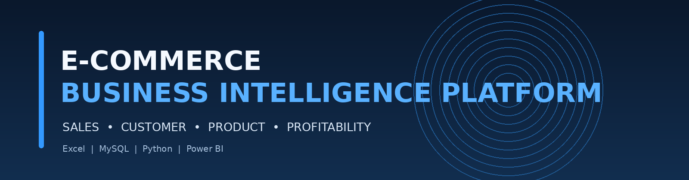
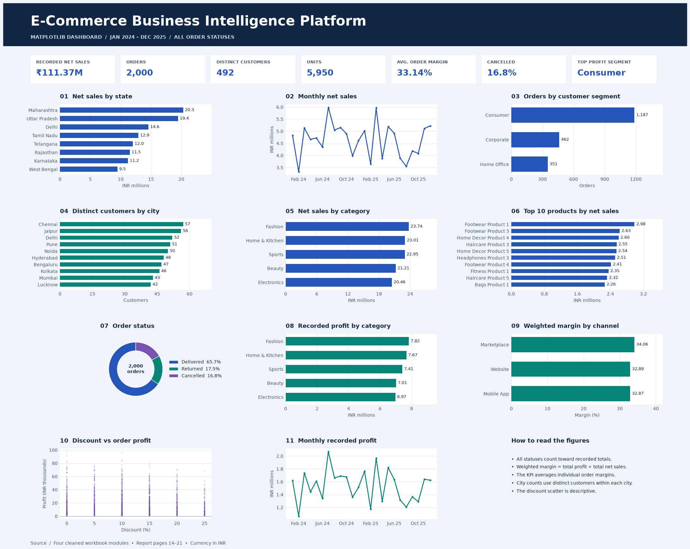
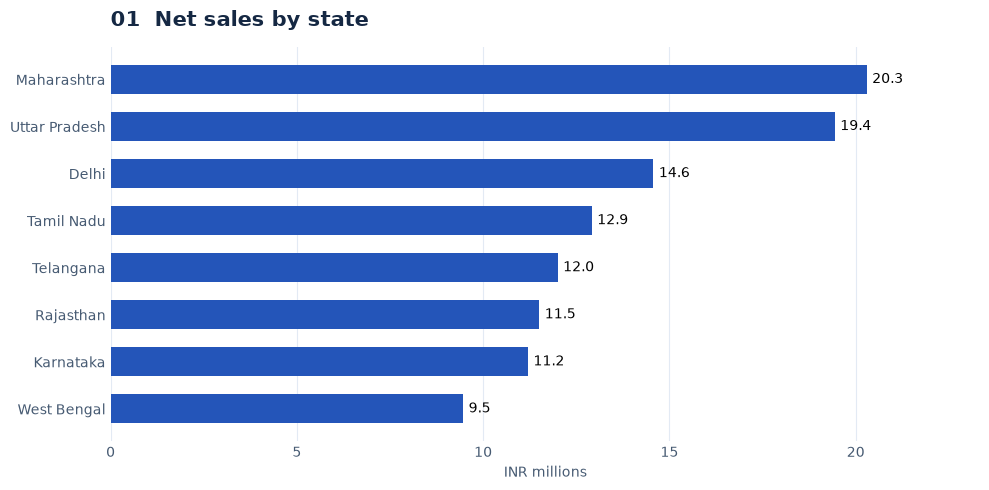
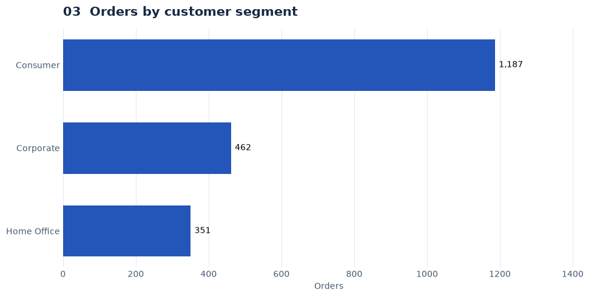
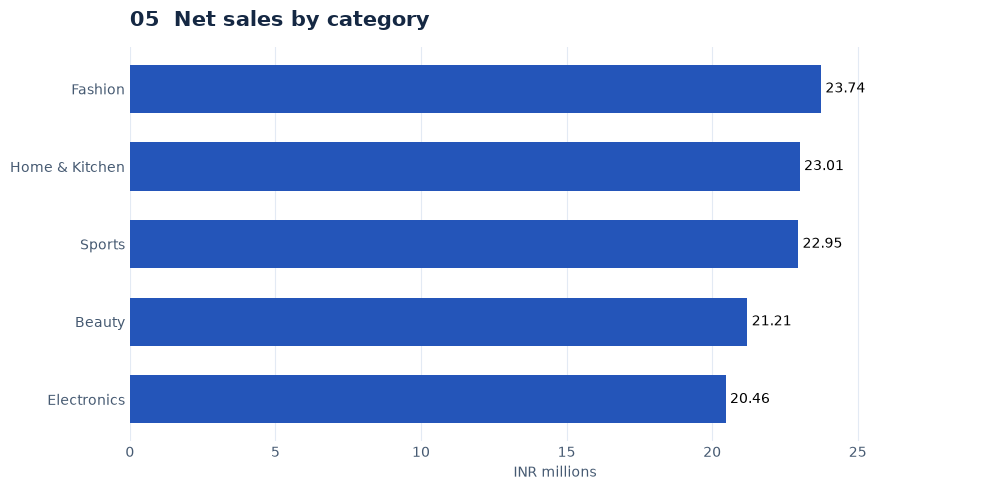
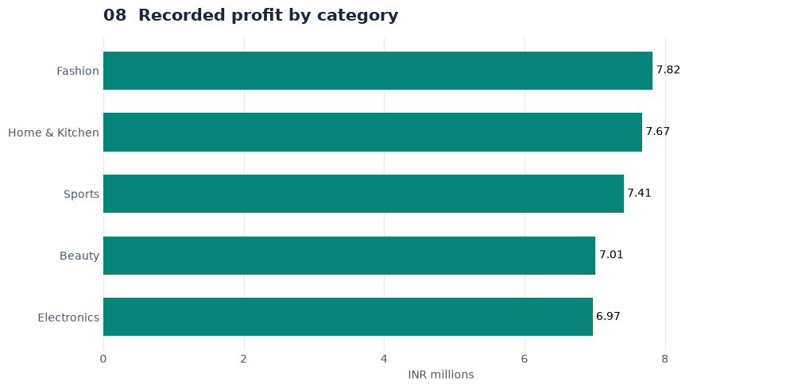

<div align="center">



# E-Commerce Business Intelligence Platform

**An end-to-end analytics project that transforms e-commerce data into actionable business insights.**

[](#)
[](#)
[](#)
[](#)
[](#)
[](#)

</div>

---

## 📌 Project Overview

The **E-Commerce Business Intelligence Platform** is a data analytics project designed to explore business performance across four key areas: **Sales, Customer, Product, and Profitability**.

The project uses an Excel workbook containing module-wise datasets and dashboards, a MySQL database as the data source for Python analysis, a Jupyter Notebook for data preparation and visualization, and a Power BI report for interactive business intelligence.

The goal is to make business performance easier to understand through KPIs, trends, comparisons, and detailed visual analysis.

## 🖥️ Dashboard Preview

The following overview is generated from the Python/Matplotlib analysis in the submitted notebook.

<p align="center">
  
</p>

## 🧩 Project Modules

### 1. Sales Analytics

Focuses on sales performance, order trends, geography, payment methods, channels, and order status.

**Analysis included:**
- Gross sales and net sales by state
- Monthly net sales trend
- Orders by customer segment
- Discount amount and quantity by payment method
- Order status distribution
- Sales channel and category comparisons

<p align="center">
  
</p>

### 2. Customer Analytics

Explores customer distribution and purchasing behaviour across customer segments and cities.

**Analysis included:**
- Customer count by city
- Orders by customer segment
- Customer and order status analysis
- Customer-level sales and profit measures
- Payment method and sales channel breakdowns

<p align="center">
  
</p>

### 3. Product Analytics

Highlights product and category performance to help identify high-performing products and product groups.

**Analysis included:**
- Net sales by product category
- Top 10 products by net sales
- Quantity by category and sales channel
- Product count by subcategory
- Discount and quantity analysis

<p align="center">
  
</p>

### 4. Profitability Analysis

Studies profit, margin, cost, shipping, discounts, and profitability across business dimensions.

**Analysis included:**
- Recorded profit by category
- Profit margin by customer segment and sales channel
- Average margin by category and channel
- Shipping cost by category
- Discount percentage versus order profit
- Monthly recorded profit trend

<p align="center">
  
</p>

## 🛠️ Tech Stack

| Technology | Role in the project |
|---|---|
| **Microsoft Excel** | Source workbook, module-wise data, pivot analysis and dashboards |
| **MySQL** | Relational database used to store and retrieve the four analytical tables |
| **Python** | Data access, preparation, aggregation and analysis |
| **Pandas** | Data loading, cleaning, grouping and KPI calculations |
| **Matplotlib** | Static charts and consolidated analytical dashboard |
| **SQLAlchemy** | Python-to-MySQL database connection |
| **Power BI** | Interactive business intelligence report (`.pbix`) |

## 🔄 Project Workflow

```text
Excel Workbook
      │
      ▼
Four Analytical Modules
(Sales • Customers • Products • Profitability)
      │
      ▼
     MySQL
      │
      ▼
Python + SQLAlchemy
      │
      ▼
Pandas Data Preparation
      │
      ▼
Exploratory Analysis & KPI Calculations
      │
      ▼
Matplotlib Visualizations
      │
      ▼
Business Intelligence Dashboards
      │
      └──────── Power BI Report
```

## 📊 Data & Quality Checks

The submitted Jupyter Notebook connects to a MySQL database named:

`e_commerce_business_intelligence_platform_v4`

It reads four tables:

| Table | Rows read in notebook | Columns |
|---|---:|---:|
| `sales` | 2,000 | 19 |
| `customers` | 2,000 | 14 |
| `products` | 2,000 | 13 |
| `profitability` | 2,000 | 19 |

The notebook performs the following checks and preparation steps:

- Checks missing values and duplicate rows
- Checks duplicate `Order_ID` values
- Removes leading/trailing spaces from column names and text values
- Converts `Order_Date` into datetime format
- Groups and aggregates data for business analysis

**Notebook check result:** the displayed checks report zero missing values, zero duplicate rows, and zero duplicate `Order_ID` values in each of the four loaded tables.

## 📈 Key KPIs Displayed

The notebook's consolidated dashboard displays these measures:

- Recorded Net Sales
- Total Orders
- Distinct Customers
- Total Units
- Average Order Margin
- Cancellation Rate
- Top Profit Segment

The notebook dashboard output shows the following recorded values for the loaded dataset:

| KPI | Displayed value |
|---|---:|
| Recorded Net Sales | ₹111.37M |
| Orders | 2,000 |
| Distinct Customers | 492 |
| Units | 5,950 |
| Average Order Margin | 33.14% |
| Cancellation Rate | 16.8% |
| Top Profit Segment | Consumer |

*These values are reproduced from the submitted notebook output and describe that dataset snapshot.*

## 📂 Repository Structure

Keep the original project files alongside this README when publishing the complete project:

```text
E-Commerce-Business-Intelligence-Platform/
│
├── README.md
├── assets/
│   ├── project-banner.png
│   ├── dashboard-overview.png
│   ├── sales-by-state.png
│   ├── customer-segment-orders.png
│   ├── product-category-sales.png
│   ├── profit-by-category.png
│   ├── monthly-sales-trend.png
│   └── discount-vs-profit.png
│
├── E Commerce Business Intelligence Platform.pbix
├── DA Project.ipynb
└── E commerce Modules With Dashboards.xlsx
```

## ⚙️ How to Run

### Prerequisites

- Python 3.x
- Jupyter Notebook
- MySQL Server
- Microsoft Excel (to explore the workbook)
- Power BI Desktop (to open the `.pbix` report)

### 1. Install Python libraries

```bash
pip install pandas matplotlib sqlalchemy mysql-connector-python jupyter
```

### 2. Prepare the MySQL database

Create the database and load the four module datasets into tables named:

- `sales`
- `customers`
- `products`
- `profitability`

The notebook expects the database name `e_commerce_business_intelligence_platform_v4` and a local MySQL connection (`localhost:3306`). Update the connection settings in the notebook if your MySQL setup is different.

### 3. Run the Jupyter Notebook

```bash
jupyter notebook
```

Open `DA Project.ipynb`, enter your MySQL password when prompted, and run the notebook cells.

### 4. Open the Power BI report

Open `E Commerce Business Intelligence Platform.pbix` using Power BI Desktop. If prompted, configure the data source credentials or refresh the dataset according to your local setup.

## 🎯 What This Project Demonstrates

- Working with multi-module business datasets
- Connecting Python to a relational database
- Data quality checks and data preparation
- SQL-based data retrieval
- Exploratory data analysis using Pandas
- KPI calculation and business metric interpretation
- Data visualization and dashboard development
- Translating raw data into business-focused insights

## 🚀 Future Enhancements

- Add automated data refresh and scheduled reporting
- Build deeper customer retention and cohort analysis
- Add forecasting for sales and profitability
- Develop drill-through analysis and more interactive filters
- Deploy dashboards for broader stakeholder access

## 👨‍💻 Project Files

- **Power BI:** `E Commerce Business Intelligence Platform.pbix`
- **Python Notebook:** `DA Project.ipynb`
- **Excel Workbook:** `E commerce Modules With Dashboards.xlsx`

---

<div align="center">

**Built with curiosity, data, and a passion for analytics.**

⭐ If you find this project interesting, feel free to explore the repository!

</div>
